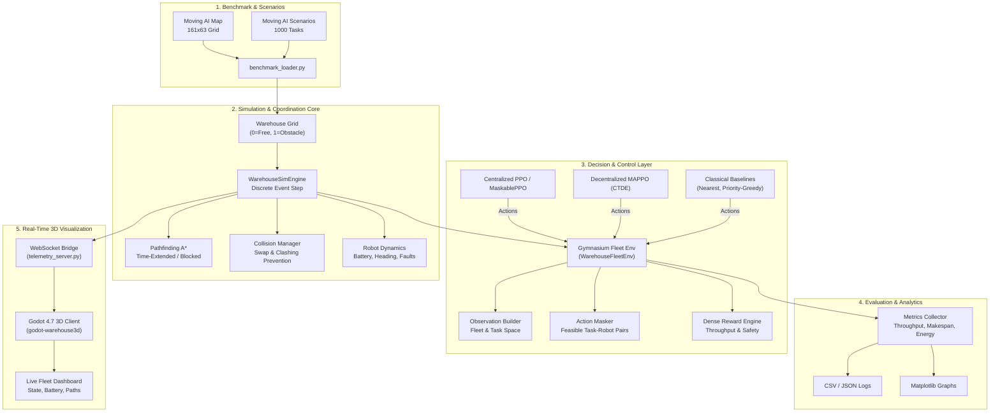

# System Architecture: RL-Based Multi-Robot Warehouse Fleet Management

## 1. Architectural Overview

The system is designed with a layered, decoupled architecture separating **Simulation Core**, **Reinforcement Learning**, **Classical Baselines**, **Experiment Harness**, and **3D Visualization**.



---

## 2. Subsystem Specifications

### 2.1 Benchmark and Coordinate Conventions
- **Benchmark Map:** `warehouse-10-20-10-2-1.map` with width $W=161$, height $H=63$.
- **Coordinate Transformation:**
  - The Moving AI scenario files specify coordinates as $(x, y)$ where $x \in [0, 160]$ and $y \in [0, 62]$.
  - The Python simulation matrix indexes cells as `warehouse[row][col]` where $\text{row} = y$ and $\text{col} = x$.
  - In Godot 3D space: $\text{Vector3}(X, Y, Z) = (\text{col} \times s - X_{\text{offset}}, 0, \text{row} \times s - Z_{\text{offset}})$, with cell scale $s$.

### 2.2 Simulation & Safety Core
- **Discrete Event Step:** The simulation executes at discrete ticks $t \in \mathbb{N}$.
- **Robot State Representation:**
  $$\mathbf{s}_i = \left( r_i, c_i, \theta_i, b_i, \phi_i, \tau_i, d_i^{\text{rem}} \right)$$
  where $(r_i, c_i)$ is grid coordinates, $\theta_i \in \{0, 1, 2, 3\}$ is heading, $b_i \in [0, 100]$ is battery percentage, $\phi_i \in \{\text{OK}, \text{FAULT}, \text{CHARGING}\}$ is fault state, $\tau_i$ is current assigned task, and $d_i^{\text{rem}}$ is remaining Manhattan path length.
- **Safety Invariant Enforcement:**
  1. *Destination Conflict Cancellation:* If robot $i$ and robot $j$ attempt to enter cell $C$ simultaneously, priority is deterministically awarded to lower robot ID while the other waits or reroutes.
  2. *Edge Swap Collision:* If robot $i$ moves $A \to B$ while robot $j$ moves $B \to A$, both moves are immediately arrested.
  3. *Stationary Obstacle Yield:* A robot planning a step into cell $C$ occupied by an immobile robot automatically halts or initiates dynamic A* rerouting with $C$ marked blocked.

### 2.3 RL Observation and Action Formulation
- **Observation Vector:** Structured fixed-length vector normalizing:
  - Robot fleet positions: $(r_i / H, c_i / W)$
  - Robot operational status: one-hot encoded (`IDLE`, `GOING_TO_PICKUP`, `GOING_TO_DROPOFF`, `CHARGING`, `FAULT`)
  - Battery levels: $b_i / 100$
  - Headings: $\theta_i / 4$
  - Top-$K$ waiting tasks in queue: normalized pickup, dropoff, priority ($1.0, 0.66, 0.33$), wait time
  - Spatial congestion heatmap summary around critical intersections
- **Action Space:** Discrete assignment index $\mathcal{A} \in \{0, 1, \dots, N_{\text{robots}} \times K_{\text{tasks}}\} \cup \{\text{NO\_OP}\}$.
- **Action Masking:** An invalid action mask $\mathbf{m} \in \{0, 1\}^{|\mathcal{A}|}$ strictly suppresses assigning busy/faulty robots or nonexistent tasks, guaranteeing $100\%$ valid action execution.
- **Reward Function:**
  $$R_t = +20 \cdot \mathbb{I}(\text{Delivery}) + 5 \cdot \mathbb{I}(\text{Pickup}) - 0.05 \sum_i \mathbb{I}(i \text{ moving}) - 0.2 \sum_i \mathbb{I}(i \text{ blocked}) - 10 \cdot \mathbb{I}(\text{Exhausted})$$

### 2.4 Classical Baselines
- **Nearest Eligible Robot (NER):** Assigns highest-priority task to the closest idle, non-faulty robot based on Manhattan distance.
- **Priority-Aware Greedy Dispatcher (PAG):** Minimizes total estimated completion time $\text{dist}(\text{robot}, \text{pickup}) + \text{dist}(\text{pickup}, \text{dropoff})$ weighted by priority tier.
- **Random Valid Policy:** Uniform random selection over masked valid actions as an empirical lower bound.

### 2.5 Real-Time Godot Visualization Bridge
- The simulation acts as the single source of truth.
- Telemetry server broadcasts JSON packets at 20-60 Hz:
  ```json
  {
    "step": 450,
    "time": 22.5,
    "robots": [
      {
        "id": 1,
        "row": 12, "col": 45,
        "heading": 90,
        "battery": 88.5,
        "state": "GOING_TO_PICKUP",
        "task_id": 14,
        "path": [[12, 46], [12, 47]]
      }
    ],
    "tasks": {
      "waiting": 3,
      "active": 4,
      "completed": 28
    }
  }
  ```
- Godot client handles linear and angular interpolation between simulation steps, displays status halos, path lines, and updates the HUD.
